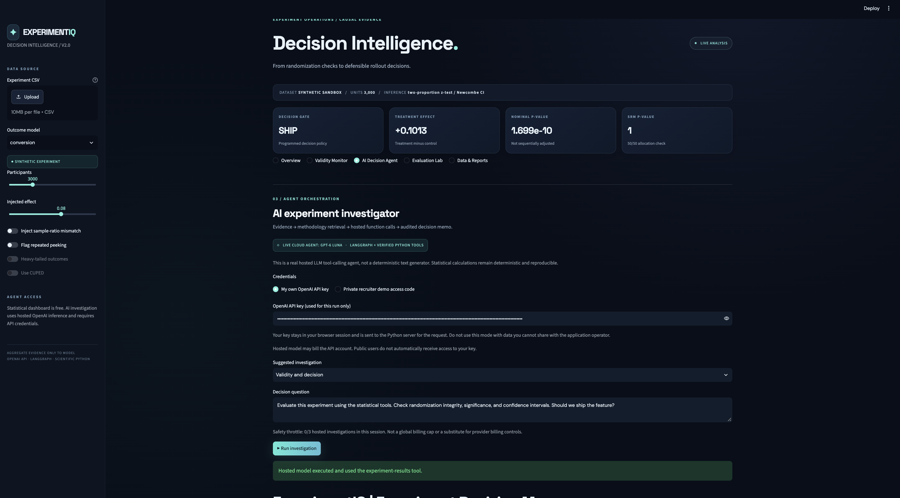
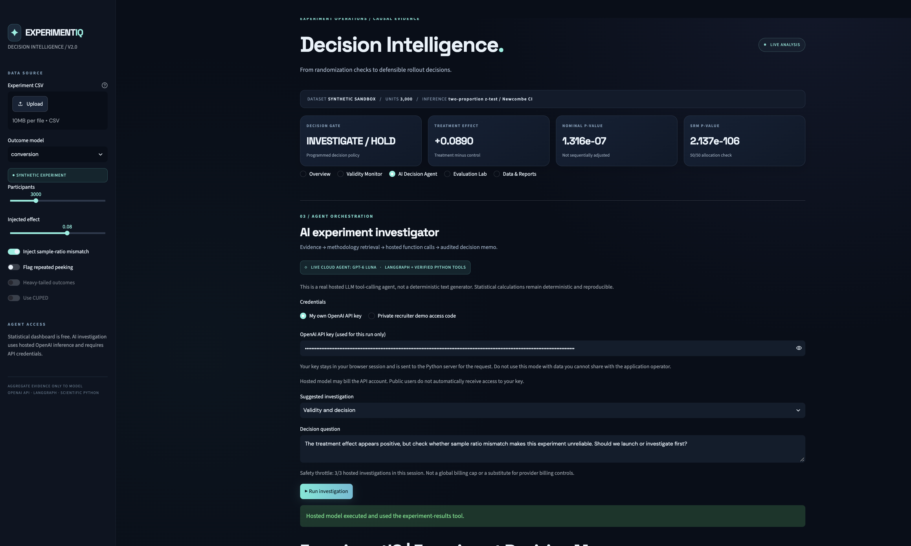
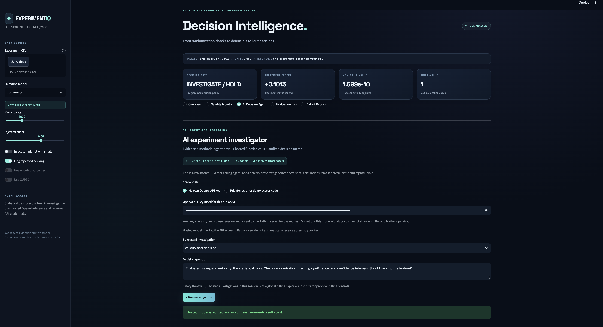
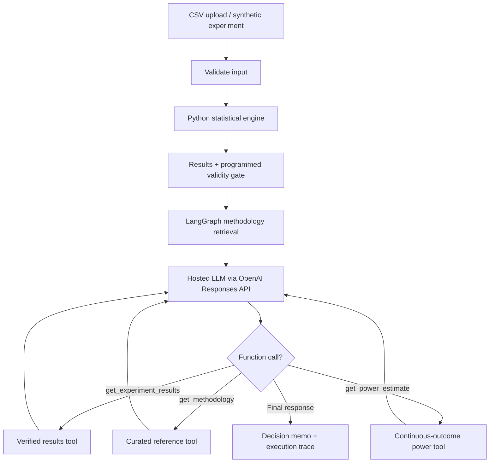

<div align="center">

# ExperimentIQ

### Agentic Experimentation & Decision Intelligence

**From experimental evidence to defensible product decisions.**

A cloud-first A/B testing platform combining reproducible statistical inference, experimental-validity diagnostics, and a **LangGraph-orchestrated AI investigator** powered by the OpenAI Responses API.


**[Live Demo — https://experimentiq-agent.streamlit.app/](#deployment)** · **[Architecture](#system-architecture)** · **[Evaluation](#evaluation--observed-results)** · **[Getting Started](#getting-started)**

</div>

---

## Overview

**A statistically significant result is not always a trustworthy launch decision.** A product experiment may show convincing uplift while suffering from sample-ratio mismatch (SRM), repeated unadjusted significance checks, or assumptions that make the reported inference unreliable.

**ExperimentIQ** is a decision-support workbench that separates three responsibilities:

1. **Compute:** Python determines effect sizes, confidence intervals, p-values, and experiment diagnostics.
2. **Investigate:** A hosted language model uses registered tools to retrieve verified results and methodology guidance.
3. **Explain:** The agent produces a structured decision memo with observed evidence, validity concerns, caveats, and an auditable tool trace.

The AI agent **does not calculate p-values by guessing**. It reads results computed by SciPy and Statsmodels. The application retains a **programmed teaching decision gate**, which the model must not override.

## Screenshots

### Decision Intelligence Dashboard



### Validity Warning — Sample Ratio Mismatch



### Hosted AI Decision Agent



> Screenshots show demonstrations using **synthetic experiment data**. Their labels and results are not production experiments.

## Key Capabilities

| Area | What ExperimentIQ implements |
|---|---|
| Experiment inputs | CSV upload or configurable synthetic experiments |
| Binary outcomes | Two-proportion z-test, absolute difference in conversion rates, Newcombe 95% confidence interval |
| Continuous outcomes | Welch t-test and corresponding confidence interval |
| Variance reduction | Optional CUPED adjustment when a pre-period covariate is provided |
| Validity diagnostics | SRM chi-square check, declared repeated peeking, and skew/small-sample warnings |
| Power planning | Approximate **continuous-outcome** sample-size estimation using Cohen's *d* |
| Decision gate | `SHIP`, `DO NOT SHIP`, or `INVESTIGATE / HOLD` based on simplified predefined rules |
| Agent reasoning | Hosted model retrieves computed results, methodology notes, and optional power estimates using function calls |
| Observability | LangGraph stage events, actual function-call trace, model status, and reported token usage |
| Exports | Decision memos, trace JSON, experiment data, and synthetic evaluation cases |
| Hosting | Streamlit Community Cloud for the UI; API-hosted model inference |

## System Architecture



The implemented LangGraph stages are:

`validate → retrieve → hosted → report`

**Model-selected tools:**

- `get_experiment_results()` — returns computed treatment/control statistics, confidence intervals, SRM result, decision gate, and warning flags.
- `get_methodology(topic)` — retrieves brief curated explanations of SRM, conversion inference, continuous outcomes, CUPED, peeking, and rollout decisions.
- `get_power_estimate(effect_size)` — estimates sample size for **continuous** outcomes; it is **not** a conversion-rate power calculator.

The methodology layer uses curated reference text, **not a vector database or general-purpose retrieval system**. Tool calls are executed by application Python code and their results are returned to the hosted model.

## Evaluation & Observed Results

### Case Study 1 — Positive Experiment, No Configured Validity Warnings

A synthetic conversion-rate experiment with balanced assignment:

| Metric | Value |
|---|---:|
| Control / treatment participants | 1,500 / 1,500 |
| Control conversion | 20.20% |
| Treatment conversion | 30.33% |
| Absolute treatment effect | **+10.13 percentage points** |
| Nominal p-value | 1.70 × 10⁻¹⁰ |
| 95% CI (absolute effect) | +7.03 to +13.21 percentage points |
| SRM p-value | 1.0 |
| Programmed gate | **SHIP** |

**Interpretation:** The observed treatment effect is positive and the configured checks raised no warnings. The AI memo appropriately framed rollout as **conditional** on correct randomization, exposure logging, measurement, and business guardrails. The gate is an educational simplification, not automatic production approval.

### Case Study 2 — Positive Uplift, Severe SRM

The same general experiment type, now with strongly imbalanced group sizes:

| Metric | Value |
|---|---:|
| Control / treatment participants | 2,100 / 900 |
| Control conversion | 20.76% |
| Treatment conversion | 29.67% |
| Absolute treatment effect | **+8.90 percentage points** |
| Nominal p-value | 1.32 × 10⁻⁷ |
| SRM p-value | 2.14 × 10⁻¹⁰⁶ |
| Programmed gate | **INVESTIGATE / HOLD** |

**Interpretation:** Statistical significance does not resolve a possible assignment, exposure, eligibility, or missingness problem. The agent recommended investigating the imbalance before launch.

### Hosted Agent Verification

Actual exported run traces demonstrate successful hosted-model execution:

- The normal experiment executed `get_experiment_results` and produced a conditional SHIP memo.
- The SRM experiment executed `get_experiment_results` and produced an INVESTIGATE / HOLD memo.
- The workflow also retrieved predefined methodological guidance in its `retrieve` stage.

These two case-study traces show **one model-selected tool call each**. Do not interpret automatic methodology retrieval by the graph as a separate model-selected tool call.

Example trace excerpt:

```json
{
  "round": 1,
  "tool": "get_experiment_results",
  "arguments": {}
}
```

### Synthetic Benchmark

The built-in benchmark comprises **20 intentionally constructed cases**: five SRM, five repeated-peeking, five strong-uplift, and five null-effect scenarios. The benchmark compares the programmed decision against a predefined expected label.

This is a **decision-gate regression benchmark**, not a real-world causal-inference benchmark and **not** a measure of LLM accuracy. Because the scenarios are designed around known rules, agreement with expected labels should not be presented as independently validated statistical performance.

Run the included tests with:

```bash
python -m pytest -q
```

Run the benchmark interactively from **Evaluation Lab** and export the case table.

## Getting Started

### Prerequisites

- Python 3.12
- Internet access for hosted AI investigations
- An OpenAI API key with API billing or available credits, **only if using the AI Decision Agent**

### 1. Clone the repository

```bash
git clone <YOUR_EXACT_GITHUB_REPOSITORY_HTTPS_URL>
cd <YOUR_CLONED_REPOSITORY_DIRECTORY>
```

> **Repository URL:** Copy the exact clone URL from GitHub's **Code → HTTPS** menu and substitute it above.

### 2. Install dependencies

```bash
python3 -m venv .venv
source .venv/bin/activate
python -m pip install -r requirements.txt
```

On Windows, activate the virtual environment using `.venv\Scripts\activate`.

### 3. Run tests and launch

```bash
python -m pytest -q
python -m streamlit run app.py
```

Visit `http://localhost:8501`.

### 4. Try the dashboard

Use the built-in synthetic experiment controls or upload a CSV containing:

| Column | Required | Description |
|---|---|---|
| `variant` | Yes | `control` or `treatment` |
| `outcome` | Yes | Binary 0/1 for conversion, numeric for continuous outcomes |
| `pre_period` | Optional | Numeric pre-experiment covariate for continuous CUPED analysis |
| `peeked` | Optional | Whether repeated peeking occurred; boolean-like values |

Select the corresponding outcome model in the sidebar. Do not upload confidential or identifiable datasets to an untrusted public deployment.

### 5. Run the hosted AI investigator

1. Open **AI Decision Agent**.
2. Choose **My own OpenAI API key** and enter your key in the password field.
3. Run an investigation, for example:

   > Evaluate the experiment's effect size, confidence interval, and SRM evidence. Explain whether the current decision gate is defensible and what must be checked before a rollout.

4. Inspect the model status and **actual model tool calls**.
5. Export the decision memo and trace to reproduce the investigation.

The application runs numerical calculations before the model call and sends aggregate evidence rather than participant-level rows to the model. The API key and data still pass through the application server, so **only enter credentials into deployments you trust**.

## Deployment

This project supports a **public Streamlit dashboard with optional hosted AI investigations**. It does not require a continuously running personal computer or a self-hosted inference server.

1. Push the project to its own GitHub repository.
2. Open [Streamlit Community Cloud](https://share.streamlit.io/).
3. Select the repository, `main` branch, and `app.py` entry point. Use Python 3.12.
4. Deploy with no secrets initially. The statistical dashboard is usable without an API key.
5. Visitors who want hosted AI can select **My own OpenAI API key**.
6. Verify the public app in an Incognito window, including a real hosted model call.

**Live application:** _Add the actual `https://...streamlit.app/` URL here after deployment._

### Optional private recruiter access

For a controlled demonstration, add these values to the app's **Streamlit Cloud Secrets** (not source code):

```toml
OPENAI_API_KEY = "YOUR_SERVER_SIDE_API_KEY"
DEMO_ACCESS_CODE = "GENERATE_A_LONG_PRIVATE_CODE"
```

A visitor with the private code can invoke the server-funded model without seeing the API key. **This does not provide a hard spending cap.** A per-session invocation limit can be bypassed by creating a new session. Keep recharge off if using prepaid credits, review provider-side controls, and monitor actual API usage. Prefer bring-your-own-key for general public access.

Never commit `.streamlit/secrets.toml`, `.env`, or real API keys.

## Project Structure

```text
ExperimentIQ_Cloud_Pro/
├── app.py                        # Streamlit Decision Intelligence UI
├── engine.py                     # Statistical tests, simulation, SRM, CUPED
├── graph_agent.py                # LangGraph orchestration + hosted tools
├── requirements.txt
├── sample_experiment.csv
├── assets/
│   └── console.css               # Custom dark SaaS styling
├── .streamlit/
│   ├── config.toml
│   └── secrets.example.toml
├── tests/
│   ├── test_engine.py
│   ├── test_graph_contract.py
│   └── test_hosted_agent.py
├── docs/
│   ├── screenshots/
│   │   ├── normal-experiment.png
│   │   ├── srm-detected.png
│   │   └── ai-decision-agent.png
│   └── Evaluation/                  # Exported example memos and traces
├── DEPLOYMENT_CHECKLIST.md
├── START_HERE.md
└── README.md
```

## Engineering Principles

- **Evidence before explanation:** Exact statistics are computed by tested Python libraries.
- **Observable execution:** The graph reports its steps; selected model tools are logged separately.
- **Explicit failure states:** The application distinguishes an unsuccessful hosted inference request from a completed AI memo.
- **Restricted inputs:** CSV structure and supported experiment arms are validated; model tool parameters are constrained.
- **Cost-aware inference:** User-provided credentials are the default for hosted analysis; server-funded recruiter access is opt-in.
- **Reproducibility:** Synthetic data, deterministic evaluation cases, tests, and exported example traces make behavior inspectable.

## Limitations & Responsible Use

ExperimentIQ is a **portfolio and educational prototype**, not a production experimentation or causal-inference system.

- Assumes 50/50 assignment for SRM checks and independent observation units.
- Uses nominal significance tests, not sequentially adjusted inference.
- Does not implement cluster-robust inference, multiple-comparison correction, guardrail metrics, exposure logging verification, or economic decision thresholds.
- The programmed SHIP label is a simplified teaching gate, **not an authorization to release software**.
- CUPED applies to supported continuous outcomes with an available pre-treatment covariate; assumptions must be reviewed.
- The curated methodology tool is intentionally limited to included guidance, not external research retrieval.
- The synthetic benchmark evaluates **predefined scenarios and decision gates**, not broader statistical accuracy or hosted-model reliability.
- Server-side processing of uploaded files and user-supplied keys creates a trust boundary. Avoid sensitive or proprietary data.

---

<div align="center">

**ExperimentIQ** · Statistical rigor, auditable agent tools, and decisions that account for experiment validity.

</div>
