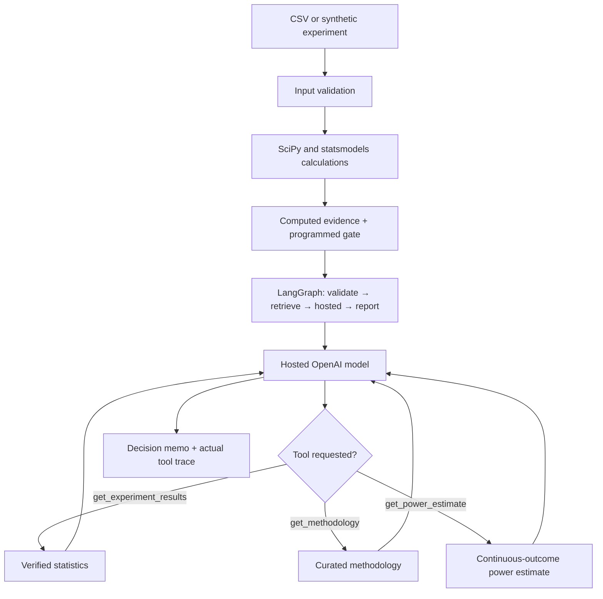

<div align="center">

# ExperimentIQ

### Experiment Decision Intelligence with Verified Statistics and Hosted AI

**Python · SciPy · statsmodels · LangGraph · OpenAI Responses API · Streamlit**

[Live Demo](https://experimentiq-agent.streamlit.app/) · [Source Code](https://github.com/karthikeyansett1/-ExperimentIQ-Agent) · [Architecture](#architecture) · [Observed Results](#observed-results) · [Getting Started](#getting-started)

</div>

---

## The problem

A statistically significant A/B test does not automatically justify shipping a feature. Sample-ratio mismatch, repeated unadjusted significance checks, and unmet experimental assumptions can undermine an apparently strong result.

**ExperimentIQ** separates reproducible statistical inference from AI-generated interpretation. Python calculates experiment outcomes and applies a simplified decision policy; a hosted language model can retrieve verified results through tools and write an auditable decision memo. It is **not** an autonomous production release system.

## What the application does

| Workspace / feature | Purpose |
|---|---|
| Overview | Compare control and treatment outcomes, effect size, confidence intervals, and the current decision gate |
| Validity Monitor | Surface sample-ratio mismatch and configured experimental warnings |
| AI Decision Agent | Ask a hosted LLM to inspect computed evidence and explain the decision using bounded tools |
| Evaluation Lab | Exercise synthetic cases against the programmed decision gate |
| Data & Reports | Inspect inputs and export data, memos, and execution traces |
| Synthetic sandbox | Configure sample size, injected treatment effect, SRM, and repeated-peeking flag |
| CSV input | Analyze supported user-uploaded experiments |

### Statistical methods

- Binary conversion: two-proportion z-test and Newcombe confidence interval for the absolute treatment–control difference.
- Continuous outcomes: Welch t-test and associated interval.
- Validity: sample-ratio mismatch check against an assumed 50/50 allocation and declared peeking warnings.
- Optional CUPED adjustment for supported continuous outcomes with a pre-period covariate.
- Approximate power planning for continuous outcomes; not a binary-conversion power calculator.

All numeric inference is computed by Python libraries, not by language-model guesses.

## Architecture



The curated methodology layer is a small predefined reference set, **not** a vector database or web-search retrieval system. The model can call registered tools but cannot change the computed statistics or programmed decision gate.

## Observed results

The following case studies were run with **synthetic** experiments. They are not production experiments or estimates of the agent's general accuracy.

| Metric | Normal experiment | Sample-ratio-mismatch experiment |
|---|---:|---:|
| Control participants | 1,500 | 2,100 |
| Treatment participants | 1,500 | 900 |
| Control conversion | 20.20% | 20.76% |
| Treatment conversion | 30.33% | 29.67% |
| Absolute effect | +10.13 percentage points | +8.90 percentage points |
| Nominal p-value | 1.70 × 10⁻¹⁰ | 1.32 × 10⁻⁷ |
| SRM p-value | 1.0 | 2.14 × 10⁻¹⁰⁶ |
| Programmed decision | **SHIP** | **INVESTIGATE / HOLD** |

**Interpretation:** Both synthetic datasets show a positive nominally significant effect, but the second has severe allocation imbalance. The programmed gate holds rollout and the agent explains why the imbalance requires investigation. The `SHIP` result is conditional and **not** production approval.

### Verified hosted tool use

In the exported normal and SRM case studies, each hosted-model investigation called `get_experiment_results` and produced an evidence-based memo. The LangGraph workflow also retrieved methodology guidance automatically. Automatic retrieval is **not** counted as an additional model-selected function call. Other observed runs have demonstrated `get_methodology` as a distinct model-selected tool.

### Synthetic decision-gate benchmark

The app includes 20 designed cases spanning sample-ratio mismatch, peeking, positive uplift, and null effects. These test the program's configured decision rules; they do **not** measure causal-inference performance or LLM accuracy.

## Getting started

```bash
git clone https://github.com/karthikeyansett1/-ExperimentIQ-Agent.git
cd -- -ExperimentIQ-Agent
python3 -m venv .venv
source .venv/bin/activate  # Windows: .venv\Scripts\activate
python -m pip install -r requirements.txt
python -m pytest -q
python -m streamlit run app.py
```

The dashboard, simulations, statistical inference, and synthetic evaluation work without an API key. For a hosted AI investigation, provide an OpenAI API key with available API credits or billing in the **AI Decision Agent** section.

### Input format

| Column | Requirement | Meaning |
|---|---|---|
| `variant` | Required | `control` or `treatment` |
| `outcome` | Required | Binary conversion (0/1) or supported numeric outcome |
| `pre_period` | Optional | Numeric pre-experiment covariate for supported CUPED use |
| `peeked` | Optional | Declared repeated-peeking indication |

Avoid identifiable or proprietary data on a deployment you do not fully control.

## Hosted demo and API-key safety

**[Launch ExperimentIQ](https://experimentiq-agent.streamlit.app/)**

Streamlit Community Cloud hosts the app; AI investigations use the hosted OpenAI Responses API. Visitors may provide their own API key in the application. Key entry passes through the running application server for the provider request, so use only a deployment you trust.

A server-side recruiter demo code can optionally be configured through Streamlit Secrets; it should not be published or treated as a spending cap. Session request throttles do not prevent determined users from starting new sessions. Never commit `.env`, `.streamlit/secrets.toml`, or a real key.

## Code layout

```text
app.py                    Streamlit interface
engine.py                 Statistical inference, validation, simulation
graph_agent.py            LangGraph and hosted model function calling
assets/console.css        Interface styling
sample_experiment.csv     Example input
tests/                    Automated tests
docs/                     Screenshots and exported example evidence
.streamlit/config.toml    Streamlit configuration
requirements.txt          Dependencies
```

## Limitations

- Decision labels are based on simplified preset rules; the tool does not authorize product releases.
- Tests assume independent units and 50/50 intended assignment for SRM.
- No sequential p-value adjustment, cluster-robust estimators, multiple-comparison control, or integrated business guardrail measurements.
- CUPED and power features have supported-input restrictions.
- Synthetic benchmark success does not imply model quality or real-world statistical validity.
- The LLM supplies explanations, not the numerical ground truth.

ExperimentIQ demonstrates experiment validation, grounded AI tool calling, and evidence-based reporting within an explicitly bounded educational scope.
