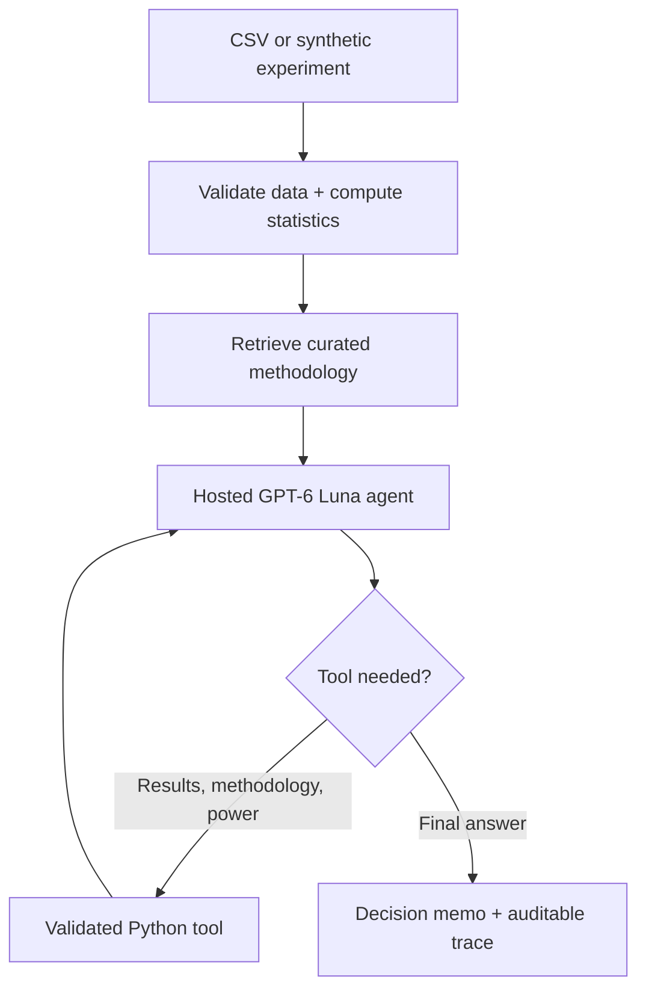

# ExperimentIQ — Cloud Decision Intelligence

**A/B experiment validation, statistical inference, and hosted AI decision support.**

ExperimentIQ is a cloud-first, LangGraph-powered experimentation workbench. It evaluates sample ratio mismatch (SRM), conversion and continuous outcomes, optional CUPED adjustment, and experimental validity warnings; it produces a reproducible decision memo. A hosted LLM **uses actual function tools to retrieve statistics and methodology**. All numerical analysis is computed by Python, not generated by an LLM.

**Stack:** Python 3.12 · LangGraph · SciPy · Statsmodels · Pandas · Plotly · Streamlit · OpenAI Responses API (`gpt-6-luna`)

> **Public demo:** Add your Streamlit URL after deployment. The statistical dashboard works without credentials. The hosted AI Investigator requires the user's own OpenAI API key or a private invite code linked to a configured server-side API key.

## Why this project matters

A significant p-value does not guarantee a trustworthy product launch. ExperimentIQ demonstrates the separation between deterministic inference, validity gates, methodology retrieval, and an agent's evidence-based narrative. A deliberately injected SRM or repeated peeking changes the decision gate to **INVESTIGATE / HOLD**, regardless of apparent uplift.

## Features

| Capability | Functionality |
|---|---|
| Experiment design checks | SRM goodness-of-fit test against assumed 50/50 assignment, declared peeking check, skew warning |
| Conversion analysis | Two-proportion z-test + Newcombe 95% CI |
| Continuous outcome analysis | Welch t-test, optional CUPED, Welch CI |
| Decision policy | Deterministic SHIP / DO NOT SHIP / INVESTIGATE-HOLD rules (simplified teaching policy) |
| Local methodology retrieval | Fixed curated guidance for SRM, CUPED, peeking, decision criteria |
| Agent orchestration | LangGraph `validate → retrieve → hosted → report` |
| Paid hosted model | GPT-6 Luna using OpenAI Responses API, actual function calls, bounded output and token count |
| Model evaluation | Tool traces + 20 synthetic benchmark scenarios; these measure different properties |
| Public demo | Streamlit Community Cloud; no self-hosted GPU required |
| Privacy | Only aggregate statistics are passed to LLM; no raw participant rows in model payload |

## Architecture




The paid model can select `get_experiment_results`, `get_methodology`, and `get_power_estimate`. The first model request requires a function call, and the application marks an answer unverified if `get_experiment_results` was not called. Results are returned by Python; the model is responsible for explanation rather than numerical computation.

## Run locally

```bash
python3 -m venv .venv
source .venv/bin/activate
python -m pip install -r requirements.txt
python -m pytest -q
python -m streamlit run app.py
```

Open `http://localhost:8501`. No Ollama installation required.

## Use the hosted AI (the only agent mode)

1. Create an API key from https://platform.openai.com/api-keys and ensure API billing is enabled.
2. Select **AI Decision Agent** (hosted GPT-6 Luna is the only agent mode).
3. Select **My own OpenAI API key** and paste your key in the password input.
4. Ask the agent to call `get_experiment_results`, then examine the actual tool trace and download the memo.

The Streamlit server handles supplied BYOK keys in memory for a request. Since this is a public Streamlit app run by its owner, **only enter keys in deployments you trust**. Never upload confidential experiment data.

### Optional recruiter invite code (server-side key)

In Streamlit Community Cloud → App settings → Secrets, add:

```toml
OPENAI_API_KEY = "YOUR_REAL_KEY"
DEMO_ACCESS_CODE = "LONG_RANDOM_PRIVATE_INVITE_CODE"
```

**Never commit `secrets.toml`.** When a visitor enters the private code, the server performs the OpenAI request. The key is never shown in the UI or included in JSON exports. You must configure provider-side spending controls; session limits do **not** enforce a global financial cap. Do not share this access code publicly.

## Deploy the dashboard and BYOK AI for free

1. Create a **new**, separate GitHub repository for ExperimentIQ.
2. Push this project's contents to `main` (do not include `.venv` or real API secrets).
3. Visit https://share.streamlit.io/ → Create app → choose your repo, branch `main`, entry file `app.py` and Python 3.12.
4. Leave Secrets empty for a public dashboard and bring-your-own-key AI access, or add optional secrets for restricted recruiter access.
5. Visit the deployed URL in an incognito browser; verify the free statistical dashboard, CSV upload, and evaluation lab. The hosted AI will prompt for credentials.
6. For paid mode, verify with a **test API key with a small spending allowance**. Check your provider usage after the test.

## Evaluation and limitations

The 20-case benchmark consists of 5 SRM scenarios, 5 declared-peeking scenarios, 5 high-uplift scenarios, and 5 null-effect scenarios. **Agreement with designed labels is not statistical validity, causal-effect recovery, or LLM accuracy**. In addition, there are automated tests of data validation and a mocked cloud function-call flow; they do not guarantee the live provider integration.

Key assumptions: 50/50 randomized allocation; independent units; one outcome; no multiple comparisons; nominal p-value not sequentially adjusted; no cluster-level inference, business guardrail integration, or valid online monitoring. The `SHIP` gate is a teaching simplification, not a real product-launch authorization.

## Cost design

- Free Streamlit hosting and statistical analysis: $0 within platform limits.
- GPT-6 Luna API: published standard rates (Oct 2026) **$0.10 / 1M input tokens and $0.50 / 1M output tokens**. Verify live rates at https://developers.openai.com/api/docs/pricing.
- A sample investigation consuming 5,000 input + 1,000 output tokens would cost roughly **$0.001**, before any applicable surcharges. Actual multi-call usage differs.
- The app offers a 3-invocation **per-browser-session** convenience limit. It is **not** an attacker-resistant, persistent, or global budget guarantee. Do not treat OpenAI budget alerts or in-app session quotas as a guaranteed hard ceiling. Keep auto-reload OFF and do not enable a shared owner key until you are comfortable with potential charges. BYOK avoids charging your account.

## Portfolio demonstration

1. Run a clean synthetic experiment with a treatment uplift and inspect the interval.
2. Toggle SRM on: the decision should change to `INVESTIGATE / HOLD` even when the estimated effect is positive.
3. Ask the hosted agent for a decision memo; capture its actual `get_experiment_results` trace.
4. Export the 20-case synthetic benchmark and explain where it does **not** measure real-world accuracy.
5. Screenshot the overview, validity monitor, hosted agent trace, and evaluation lab into `docs/screenshots/`, then reference them here.

## Responsible use

For educational and portfolio demonstrations. Not a clinical, legal, financial, or automated product-deployment decision system. Uploaded rows are processed on the application server; do not upload sensitive or proprietary datasets to a public demo.
